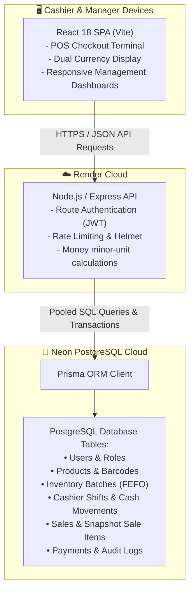

# 🛒 Supermarket POS — Team Guide & Presentation Roadmap

Welcome to the **Supermarket POS (Point of Sale & Inventory Management System)**!  
This document is designed for your school project team. It explains **what the system does**, **why we built it**, **the technologies used**, and **step-by-step instructions for live presentations and exams**.

---

## 📌 Table of Contents
1. [Project Overview & Purpose](#1-project-overview--purpose)
2. [Technology Stack](#2-technology-stack)
3. [System Architecture Diagram](#3-system-architecture-diagram)
4. [Roles & Permissions (RBAC)](#4-roles--permissions-rbac)
5. [Demo User Accounts](#5-demo-user-accounts)
6. [Core System Modules](#6-core-system-modules)
7. [Step-by-Step Presentation Script](#7-step-by-step-presentation-script)
8. [Local Development Commands](#8-local-development-commands)
9. [Deployment & Hosting Notes](#9-deployment--hosting-notes)

---

## 1. Project Overview & Purpose

### What is this system for?
In modern retail and supermarkets (particularly in Cambodia and Southeast Asia), cashiers and store managers face daily challenges:
- **Dual-Currency Reality:** Customers frequently pay in both **USD ($)** and **Cambodian Riel (KHR)**. Manually calculating change or exchange rates leads to human error.
- **Perishable Goods & Expiry Waste:** Supermarket items (dairy, produce, packaged goods) expire quickly. Without batch tracking, old items spoil on shelves while newer stock is sold first.
- **Cash Theft & Drawer Discrepancies:** Without cashier shift opening/closing floats and reconciliation, cash register imbalances go unnoticed.
- **Speed at Checkout:** Long lines require fast barcode scanning, quick category filtering, and rapid payment processing (Cash + KHQR digital payment).

### What does this project deliver?
A full-stack, enterprise-grade supermarket POS application featuring:
- **Live POS Terminal** with barcode search, quick category chips, fast quantity controls, and dual-currency conversion.
- **FEFO (First-Expired, First-Out) Inventory Engine** that automatically pulls from the oldest valid batch so expiring goods are sold first.
- **Cashier Shift Reconciliation** tracking opening float, expected cash vs. counted cash, and cash-in/cash-out movements.
- **Cambodia KHQR Simulation** allowing digital mobile payments with instant cashier approval.
- **Strict Role-Based Access Control (RBAC)** across 4 distinct user roles.

---

## 2. Technology Stack

| Layer | Technology | Why We Used It |
| :--- | :--- | :--- |
| **Frontend** | React 18 + Vite | Lightning-fast build times, component-based UI, reactive state management |
| **Icons & Styling** | Lucide React + Clean CSS | Modern, lightweight retail dashboard design with zero heavy UI library bloat |
| **Backend API** | Node.js + Express.js | Scalable REST API, standard middleware architecture (CORS, Helmet, Rate Limiter) |
| **ORM** | Prisma ORM | Type-safe database queries, auto-generated migrations, transaction safety |
| **Database** | PostgreSQL on Neon | Serverless cloud PostgreSQL with connection pooling and high reliability |
| **Security** | Argon2 / JWT | Industry-standard password hashing and stateless token authentication |
| **Hosting** | Render.com | Free cloud web service (Backend) and static site hosting (Frontend) |

---

## 3. System Architecture Diagram



---

## 4. Roles & Permissions (RBAC)

The system enforces strict server-side authorization:

| Role | POS Checkout | Shifts & Cash | Inventory & Stock | Suppliers & POs | Reports & Sales | User Management |
| :--- | :---: | :---: | :---: | :---: | :---: | :---: |
| 👑 **Owner** | ✅ Full | ✅ Full | ✅ Full | ✅ Full | ✅ Full | ✅ Full |
| 🛡️ **Admin** | ✅ Full | ✅ Full | ✅ Full | ✅ Full | ✅ Full | ❌ Restricted |
| 🛒 **Cashier** | ✅ Full | ✅ Own Shift | ❌ View Only | ❌ No | ❌ Own Sales Only | ❌ No |
| 📦 **Inventory Manager** | ❌ No | ❌ No | ✅ Full | ✅ Full | ❌ Stock Reports | ❌ No |

---

## 5. Demo User Accounts

We have created 3 pre-configured demo accounts in the live database for easy testing and presentations.  
*(Note: On the login screen, you can also click the **Demo Accounts (1-Click Fill)** buttons to fill in the username and password instantly!)*

| Role | Username | Password | Purpose for Presentation |
| :--- | :--- | :--- | :--- |
| **Store Owner** | `owner` | `password123` | Demonstrates full administrative control, sales analytics, store settings, and user management. |
| **Cashier** | `cashier` | `password123` | Demonstrates opening a shift, scanning barcodes, dual-currency checkout, KHQR, and closing shifts. |
| **Inventory Manager** | `inventory` | `password123` | Demonstrates batch tracking, expiry dates (FEFO), supplier purchase orders, and stock receiving. |

---

## 6. Core System Modules

### 1. POS Checkout (`/pos`)
- **Fast Search & Barcode Lookup:** Enter a product name or scan a barcode to immediately add items to cart.
- **Category Filter Chips:** Rapidly filter between Beverages, Dairy, Snacks, Pantry, Produce, etc.
- **Dual Currency:** Live conversion between USD and KHR (e.g., $1.00 = 4,100 KHR, customizable in Settings).
- **Payment Modals:**
  - **Cash:** Quick denomination buttons ($1, $5, $10, $20, $50, $100) with automatic change calculation in both USD and KHR.
  - **Bakong / KHQR:** Displays an authentic vector QR code with invoice reference number for digital payments.
- **Receipt Dialog:** Instant printable thermal receipt snapshot.

### 2. Cashier Shifts (`/shifts`)
- Cashiers must start a shift with an **Opening Float** (initial cash drawer balance).
- Cash movements (paid-in / paid-out) can be recorded during shifts for transparency.
- When closing a shift, the cashier enters the physical cash counted; the system computes any **Over / Short variance** to prevent unrecorded drawer shortages.

### 3. Inventory & Batches (`/inventory`)
- Implements **FEFO (First-Expired, First-Out)** batch tracking:
  - Each product has distinct stock batches with batch numbers, costs, and expiry dates.
  - POS sales automatically deduct inventory from the oldest expiring batch first.
- Visual alerts for Low Stock, Expiring Soon (< 30 days), and Expired batches.

### 4. Purchasing & Suppliers (`/purchasing/orders` and `/purchasing/suppliers`)
- Track vendor profiles, contact details, and payment terms.
- Issue Purchase Orders (Draft ➔ Ordered ➔ Received ➔ Cancelled).
- Receiving goods automatically creates new inventory batches and updates stock levels.

### 5. Sales & Audit Trail (`/sales` and `/audit`)
- Immutable sales records: Item names, prices, and quantities are stored as historical snapshots so future product price edits do not corrupt past accounting.
- Comprehensive audit log tracking which user performed which action and at what timestamp.

---

## 7. Step-by-Step Presentation Script

Here is an ideal 5-minute walkthrough script your team can follow when demonstrating the system to your instructor or classmates:

### Step 1: Login & Shift Opening (1 Minute)
1. Navigate to the Login page. Click the **"🛒 Cashier"** quick-fill button, then click **Sign In**.
2. Notice the top bar indicates: *"No Active Shift"*.
3. Go to **Cashier Shifts** ➔ Click **"Open New Shift"**.
4. Enter an opening float of `$50.00` and click **Confirm**. Notice the top bar now turns green: *"Active Shift #..."*.

### Step 2: Live POS Checkout & Dual Currency (2 Minutes)
1. Click **POS Checkout** in the sidebar.
2. Select a category (e.g., *Beverages*) and click an item (e.g., *Coca Cola Can* or *Angkor Premium Beer*), or search via barcode.
3. Adjust quantities using the `+` / `-` buttons.
4. Point out the total displayed in both **USD ($)** and **KHR (៛)**.
5. Click **"Pay Now"**:
   - Choose **Cash**: Click the `$10.00` denomination chip. Show the teacher the calculated change in USD and KHR.
   - Or choose **KHQR**: Show the generated QR code modal.
6. Click **Complete Payment** ➔ View the printable receipt popup!

### Step 3: Shift Closing & Cash Reconciliation (1 Minute)
1. Go back to **Cashier Shifts**.
2. Click **Close Shift**.
3. The system shows the opening float ($50.00) + cash sales made. Enter the physical counted drawer amount.
4. Click **Close Shift** to finalize the reconciliation record.

### Step 4: Management & Analytics (1 Minute)
1. Log out, then click **"👑 Owner"** quick-fill button and sign in.
2. Highlight the **Overview Dashboard**:
   - Today's Revenue and Completed Orders.
   - Low Stock and Expiring Batch warnings.
3. Show **Inventory Summary** to demonstrate the FEFO batch expiry dates.
4. Show **Audit Logs** to prove that every user action and sale is logged for security and accountability.

---

## 8. Local Development Commands

If any team member wants to run the project locally on their computer:

### Prerequisites:
- Node.js (v18 or v20+)
- Git

### 1. Backend Setup:
```powershell
cd backend
npm.cmd install
# Copy environment file
cp .env.example .env
# Push database schema & seed demo data
npx.cmd prisma db push
node prisma/seed.js
# Start development server
npm.cmd run dev
```
*Backend runs on: `http://localhost:5000`*

### 2. Frontend Setup:
```powershell
cd frontend
npm.cmd install
# Copy environment file
cp .env.example .env
# Start Vite development server
npm.cmd run dev
```
*Frontend runs on: `http://localhost:5173`*

---

## 9. Deployment & Hosting Notes

- **Backend (Render Web Service):**
  - Build Command: `npm install && npx prisma generate`
  - Start Command: `node src/app.js`
  - Environment variables: `DATABASE_URL`, `JWT_SECRET`, `NODE_ENV=production`, `PORT=5000`.
- **Frontend (Render Static Site):**
  - Build Command: `npm install && npm run build`
  - Publish Directory: `dist`
  - Environment variables: `VITE_API_BASE_URL` pointing to the Render backend URL (e.g. `https://supermarket-pos-backend.onrender.com/api`).
- **Neon PostgreSQL:**
  - Cloud serverless PostgreSQL database with automatic connection pooling (`?sslmode=require`).

---

*Good luck with your school project presentation! 🚀*
